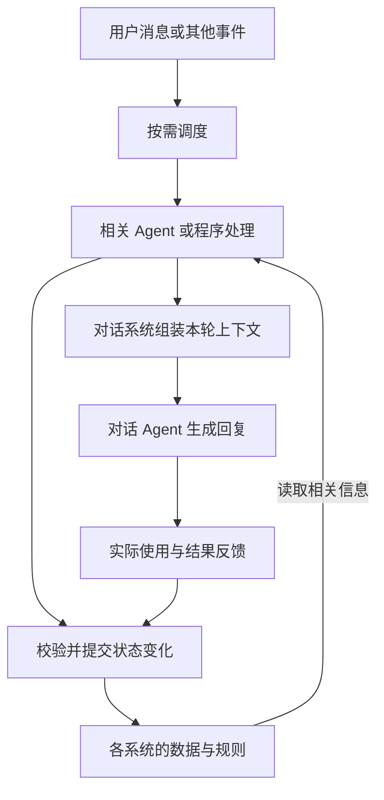

# 仿真人聊天系统：设计思路与阶段反思

本文整理当前交流中形成的思路，作为后续研究和设计的起点。系统划分与 Agent 职责仍是初步设想，不代表已经实现，也没有确定完整记忆系统的底层架构。

## 1. 当前目标与已有工作的定位

目标是让角色的交流具有经历、时间和关系上的连续性：既能利用过去的信息，也能表现出不同程度的记忆清晰度，并让经历影响后续认识与行为。

目前具体展开并做了 Demo 的核心是记忆强度，包括形成时的初始强度、随时间衰减、成功回忆后的强化。代码还串起了记忆提取、向量化、本地存储、检索和多轮对话，但这些配套功能不意味着已经完成一套仿人记忆系统。

从 300 条记忆中找到书名、地址或生日，主要体现语义检索能力。仿人目标还需要另外验证：时间、记忆清晰程度、情绪、关系和认识是否合理地改变了回答或行动。

## 2. 记忆强度的价值与归属

### 2.1 它是记忆系统中的一个属性与变化机制

记忆强度描述角色对某段经历“现在记得多清楚”，是完整记忆系统的一部分。它本身不能单独构成存储、关联、更新和检索架构。

虽然最后可以表现为一个参数，但它承载的是过去状态、时间流逝和回忆经历的计算结果。是否值得保留，取决于它能否带来可观察的行为差异，而不是参数数量或代码长度。

| 信息 | 在本次设计中表达什么 |
| --- | --- |
| 经历发生时间、当前时间 | 这件事发生在何时，距离现在多久 |
| 当前记忆强度 | 角色现在记得多清楚 |
| 当前情绪、人物关系 | 角色现在怎样看待这段经历、怎样表达 |

久远的事情不一定模糊，重要且反复回忆的事情仍可能清楚。时间与强度也不能单独决定情感表达，需要结合人物状态、关系和经历内容。

### 2.2 本阶段将相关性与清晰度分开

| 维度 | 回答的问题 | 本阶段的职责 |
| --- | --- | --- |
| 语义相似度 | 哪些记忆与当前问题相关？ | 寻找相关历史内容 |
| 当前记忆强度 | 对这段经历还记得多清楚？ | 影响细节、确定程度和是否请求线索 |

当前倾向是不再直接将两者加权成一个综合分，而是先找相关记忆，再用强度控制回忆呈现和回答方式。这是当前模块的职责选择，不是“强度在任何系统里都不能参与检索”的通用结论。

相似度和强度都不能证明事实正确，也不能替代对人物、事件、条件、来源和有效时间的核对。

### 2.3 对话中应当能感受到区别

例如，同一段“用户邀请我去市图书馆，并提醒带上夹着蓝色便签的《活着》”：

- 较清晰时，可以回忆书名和有关细节，但不能因此声称已经答应邀请或完成归还。
- 较模糊时，可能只记得借书、带书的主线，对次要细节表达不确定。
- 很低时，可以表示暂时想不起来，请用户提供区分线索。

仅仅在完整答案前加一句“有点记不清”，却仍准确复述全部细节，不能体现这种差异。若文字规则约束不足，再考虑限制不同清晰程度下可提供给模型的细节。

低强度不应被实现成随机编造错误细节。用户本轮明确提供的内容、短期原话中已有的信息，也不能因为长期记忆模糊而被假装忽略。

## 3. 按系统划分能力

系统用于明确数据和规则的归属；Agent 执行理解、判断和处理。下面是第一版业务能力划分，不要求分别部署成独立服务。

| 系统 | 核心问题 | 管理的内容 |
| --- | --- | --- |
| 记忆系统 | 我经历过什么？ | 记忆形成、关联、提取、衰减、强化、记忆内容及状态维护 |
| 情感系统 | 这件事让我有什么感受？ | 情绪类型、强度、事件影响、随时间恢复 |
| 人物关系系统 | 我与这个人是什么关系？ | 熟悉程度、信任、亲近程度、关系经历、交往边界 |
| 人格与身份系统 | 我是谁，通常怎样看待事情？ | 背景、性格、价值观、稳定偏好、表达习惯 |
| 人物状态系统 | 我现在处于什么处境？ | 精力、活动、环境、注意力、忙碌程度 |
| 认知与反思系统 | 这些经历意味着什么？ | 关联经历、形成认识、保留依据、修正判断 |
| 目标与行动系统 | 我想做什么，接下来做什么？ | 当前目标、计划、承诺、未完成事项、主动联系意向 |
| 对话系统 | 此刻适合怎样回应？ | 综合本轮相关信息和建议，生成回答 |

情绪、关系和人格需要不同的变化规则。一次不愉快可以影响当下情绪，但不应立即彻底改写长期信任或人格。

“经历过什么”与“目前怎样理解它”也应区分。事实来源、历史变化与当前认识的具体存储边界，后续仍需细化。

## 4. Agent 与系统是多对多关系

一个 Agent 可以读取或影响多个系统，一个系统也可以由多个 Agent 使用。不需要每增加一个功能或系统，就增加一个 Agent。

| Agent 或处理角色 | 初步职责 |
| --- | --- |
| 记忆 Agent | 形成值得保存的记忆，初始化相关字段，提交存储或更新 |
| 提取 Agent | 寻找相关记忆，计算当前强度，提供本轮可用的回忆资料 |
| 心理活动 Agent | 结合经历、状态和关系调整情绪，形成认识或行动意向 |
| 事件 Agent／事件处理 | 处理时间到达、环境变化、行动结果等事件，触发所需流程 |
| 对话 Agent | 根据整理后的上下文生成实际对用户说的话 |

是否独立成 Agent，应取决于处理职责、所需上下文和运行时机。公式计算、数据库读写、校验和上下文拼装可以由程序完成。

需要明确各 Agent 能读什么、能修改哪些字段。写入由程序校验并按既定规则执行，避免多个 Agent 随意覆盖同一状态，也避免无边界地相互调用。

## 5. 系统之间怎样相互影响

系统划分职责，但不彼此隔离。归属一个系统的数据，可以受其他系统影响，再被多个 Agent 使用。

以记忆强度为例：

```text
经历发生当时的人物状态
    → 影响留意程度、事件评价和保留的细节
    → 形成记忆内容与初始强度
    → 时间与实际回忆影响当前强度
    → 当前强度影响对话中的回忆呈现
```

这里应使用形成记忆时的状态快照，不应用今天的心情覆盖过去当时的状态。

影响也可以反过来：某段记忆被唤起，可能引起情绪变化；对多次经历的反思，可能改变人物关系判断和后续计划。

例如用户说“最近赶论文，消息可能回得慢”，后续处理可能包括：

| 系统 | 可能的变化 |
| --- | --- |
| 记忆 | 记录用户表示正在赶论文，可能回复较慢 |
| 认知 | 将暂时没回复理解为可能忙碌，不直接推断为关系疏远 |
| 情感 | 结合角色与用户的关系产生关心等模拟反应 |
| 目标与行动 | 产生稍后关心进展的意向，再判断是否适合打扰 |
| 对话 | 本轮减少催促，提供适当支持 |

这是可能的协作示例，不要求每条消息都触发全部系统。

反思产生的认识需要与事实分开。“用户两次没回复”是经历，“用户可能在忙”是推测，不能直接把“用户讨厌我”保存为确定事实。推测应保留依据，并允许新经历修正。

## 6. 记忆 Agent、提取 Agent 与强化反馈

记忆强度的字段归属记忆系统，具体流程可以分成三步：

| 时机 | 处理 |
| --- | --- |
| 形成记忆 | 记忆 Agent 结合当时状态评价内容，程序初始化强度、创建时间、稳定性、回忆次数等字段并存储 |
| 提取记忆 | 提取 Agent 检索相关内容，程序依据当前时间和强化记录计算当前强度，提供正文、时间和清晰程度 |
| 实际使用后 | 根据反馈确认使用了哪些长期记忆，再更新回忆次数、上次回忆时间和强化字段 |

关键区别是：检索命中、正文进入上下文、模型说“记不清”，都不自动等于成功回忆。不能因为成为候选就强化所有记录，也不能用衰减后的当前强度覆盖初始强度。

记忆中的经历发生时间、系统获知时间、创建时间、上次回忆时间可能不同，后续设计应分别明确含义。

## 7. 不同系统使用适合自己的查询方式

各系统不必共享同一种检索机制。先确定需要查询什么，再选择数据组织与索引。

| 系统或需求 | 可考虑的读取方式 |
| --- | --- |
| 当前人物状态、当前情绪 | 按人物 ID 直接读取 |
| 人物关系 | 按人物组合和关系类型查询 |
| 当前目标、待办和到期事项 | 按状态、时间、所属人物查询 |
| 相关经历 | 语义、关键词、时间范围、人物或事件关联等方式配合 |

之前考虑的 B+ 树思路，可以先归入记忆系统的索引候选方案。它适合对时间等有序字段做范围查询、顺序读取；它不是语义相似检索的直接替代品。

目前还没有确定索引哪些字段、怎样与其他检索方式协作，也没有决定自行实现 B+ 树。具体设计留待需求与项目调研之后。

## 8. 完整记忆系统需要进一步研究的能力

当前 Demo 采用向量检索辅助生成回答。向量检索可以继续作为组件，完整设计还需要围绕以下四项展开：

1. **记忆形成关联**：把借书、图书馆邀请、带书提醒、后来归还等内容关联成一段经历，支持沿线索回查。
2. **经历形成新认识并影响行为**：从多次经历产生有依据、可修正的理解，影响情绪、表达、计划或主动行为。
3. **准确维护关系与事实变化**：区分人物和动作方向，保存邀请、确认、改期、完成等变化，区分历史情况与当前情况。
4. **在合适时机唤起记忆**：除了用户问题，还能由事件、时间、人物状态、未完成事项或后台反思触发。

这些能力不能只靠增加衰减公式完成。后续准备继续阅读 GitHub 项目，研究记忆组织、关联、更新、触发和行为反馈，再确定底层方案。

### 8.1 GitHub 项目总览

下面依据 2026 年 11 月 9 日核对的仓库说明及部分核心源码整理，作为阅读线索。项目能力介绍与针对本项目的迁移设想分别说明；尚未运行验证，也没有确定接入这些组件。

| 项目 | 项目侧重 | 与当前设计问题的对应关系 |
| --- | --- | --- |
| [Generative Agents](https://github.com/joonspk-research/generative_agents) | 经历、反思、计划与行为 | 记忆怎样形成新认识，并影响人物后续行为 |
| [A-Mem](https://github.com/agiresearch/A-mem) | 记忆笔记、关联与演化 | 独立的记忆正文怎样建立联系 |
| [Graphiti](https://github.com/getzep/graphiti) | 实体关系、事实变化与时间 | 谁与谁有什么关系，哪些事实现在有效 |
| [Letta](https://github.com/letta-ai/letta-code) | Agent 管理记忆与上下文、后台整理 | 长期积累的信息怎样被组织和持续使用 |

### 8.2 Generative Agents：经历怎样影响认识与行为

**项目定位。** 这是模拟人物在虚拟小镇中生活的研究项目，提供人物模拟模块和游戏环境。[项目说明](https://github.com/joonspk-research/generative_agents)

**核心流程。** 人物保存观察到的经历，通过检索提取有关内容。积累的重要性达到触发条件后，反思模块生成值得思考的问题，寻找相关经历，再生成带有依据引用的想法并保存。计划模块还会利用有关经历更新人物当前处境和日程。[反思源码](https://github.com/joonspk-research/generative_agents/blob/main/reverie/backend_server/persona/cognitive_modules/reflect.py)、[计划源码](https://github.com/joonspk-research/generative_agents/blob/main/reverie/backend_server/persona/cognitive_modules/plan.py)

```text
观察与保存经历 → 检索有关内容 → 反思形成认识 → 影响计划与行为
```

**对本项目的启发。** 例如多次经历用户赶论文时回复较慢，角色可能形成“这个时期适合少打扰”的认识，再影响联系时机。这是迁移示例；具体认识应保留依据并允许修正，不能把推测直接记成事实。

**阅读入口。** 可以先阅读认知模块，不必先部署整个小镇：

- `reflect.py`：关注 `reflection_trigger()`、`run_reflect()`、`generate_insights_and_evidence()`，理解何时反思、检索什么、如何关联依据。
- [retrieve.py](https://github.com/joonspk-research/generative_agents/blob/main/reverie/backend_server/persona/cognitive_modules/retrieve.py)：关注如何寻找相关经历与想法。
- `plan.py`：关注 `revise_identity()`，追踪旧经历怎样参与人物处境与计划更新。

优先借鉴认知流程。仓库同时包含模拟环境和运行配套，整体结构不需要直接照搬到聊天项目。

### 8.3 A-Mem：独立记忆怎样形成网络

**项目定位。** A-Mem 将记忆组织成带结构化属性的笔记，使用 ChromaDB 寻找有关内容，并通过模型判断关联和记忆演化。[项目说明](https://github.com/agiresearch/A-mem)

**核心流程。** 记忆笔记包含正文、关键词、标签、上下文和其他记忆的链接等字段。新记忆加入时，系统寻找相关旧记忆，让模型判断是否建立链接、调整标签或更新邻近记忆的上下文；源码也包含沿记忆链接补充有关内容的检索流程。[核心源码](https://github.com/agiresearch/A-mem/blob/main/agentic_memory/memory_system.py)

```text
新记忆 → 寻找有关旧记忆 → 判断联系 → 更新关联、标签或上下文
```

**对本项目的启发。** 可以研究怎样关联“用户把《活着》借给我”“图书馆邀请中提醒带书”“用户后来更改见面时间”等片段，帮助还原同一段经历。

**阅读入口。** 在 `agentic_memory/memory_system.py` 中依次阅读：

- `MemoryNote`：一条记忆有哪些结构化属性。
- `add_note()`、`process_memory()`：新记忆怎样进入系统、怎样参与关联与演化。
- `search_agentic()`：检索结果与关联记忆怎样组织。

标签和上下文的演化，与“旧事实已经失效”的处理规则需要分别考虑。链接是否正确、是否实际改善返回结果，也需要结合运行表现验证。仓库说明将论文结果复现指向另一个 [AgenticMemory 仓库](https://github.com/WujiangXu/AgenticMemory)，阅读时应区分用途。[仓库说明](https://github.com/agiresearch/A-mem#introduction-)

### 8.4 Graphiti：关系与事实变化怎样被保存

**项目定位。** Graphiti 是构建和查询时序上下文图的框架，将输入资料组织为实体、关系事实和来源经历，维护事实的时间变化，并支持语义、关键词和图遍历相结合的检索。[项目说明](https://github.com/getzep/graphiti)

**核心表示。** 可以把它理解为三类内容：人物等实体、实体之间的关系事实、产生这些事实的原始经历。关系事实包含来源引用及 `valid_at`、`invalid_at`、`expired_at` 等时间字段。[事实结构源码](https://github.com/getzep/graphiti/blob/main/graphiti_core/edges.py)

**对本项目的启发。** 例如用户以前住松林路十号，后来搬到二十六号，需要分别回答现在住哪里、以前住哪里、地址何时变化、依据哪次交流。可以借鉴其组织方式，而不是仅把两条地址正文都作为同等有效的候选交给模型。

这里的时间主要描述事实何时有效，与“角色记得多清楚”是两个独立维度。已失效的旧事实可能仍被记得很清楚。

**阅读入口。**

- [graphiti_core/graphiti.py](https://github.com/getzep/graphiti/blob/main/graphiti_core/graphiti.py)：查看 `Graphiti` 类和经历写入、查询入口。
- `graphiti_core/edges.py`：查看 `EntityEdge` 的事实、来源和时间字段。
- [graphiti_core/search/search.py](https://github.com/getzep/graphiti/blob/main/graphiti_core/search/search.py)：查看不同检索方式与重排如何配合。

接入范围也要纳入考虑：Graphiti 需要配合图数据库、语言模型和嵌入模型使用，服务封装等仍由应用负责。[部署职责说明](https://github.com/getzep/graphiti#graphiti-and-zep)

### 8.5 Letta：Agent 怎样持续管理记忆与上下文

**项目定位。** Letta 提供有持续状态的 Agent 运行框架。当前设计使用可检查、可编辑的记忆文件系统 MemFS，记忆可以跨交流持续维护。[当前项目](https://github.com/letta-ai/letta-code)、[记忆说明](https://docs.letta.com/configuration/memory)

**核心思路。** Agent 学到值得长期保存的信息后，可以决定放在哪里并更新记忆。后台整理机制会回顾近期交流、提炼经验、整理记忆，在活动对话之外完成部分处理。[记忆与后台整理说明](https://docs.letta.com/configuration/memory)

**对本项目的启发。** 可以研究如何把多次交流整理成有依据的用户画像、习惯或经验，并维护、修正这些描述；再研究哪些内容常驻上下文、哪些内容需要时再读取。这与后续控制 Prompt 增长的问题直接相关。

**阅读入口。** 先阅读官方文档中的 Memory & dreaming、MemFS，再对应源码追踪记忆读取、更新和后台任务的调用路径。

阅读时注意版本：旧 [letta-ai/letta](https://github.com/letta-ai/letta) 仓库说明活跃源码已经迁至 `letta-ai/letta-code`；旧 V1 服务源码保存在 `archive` 分支。理解旧方案与采用当前代码时应分别确认入口。[迁移说明](https://github.com/letta-ai/letta#historical-source)

### 8.6 建议的阅读顺序与记录问题

按当前项目目标，先后顺序可以是：Generative Agents → A-Mem → Graphiti → Letta。

| 顺序 | 本次阅读优先回答的问题 |
| --- | --- |
| 1 | 怎样从经历产生有依据的认识，再影响人物行为？ |
| 2 | 新记忆怎样与旧记忆建立关联，关联怎样被使用？ |
| 3 | 怎样区分人物关系、历史事实和当前有效事实？ |
| 4 | 谁来管理长期资料，怎样控制本轮上下文和后台整理？ |

每次先追踪一条完整数据路径：新经历怎样进入、如何组织或更新、怎样被再次找到、结果如何影响表达或行为。将项目已实现的机制、说明中提出的能力、自己的迁移设想分别记录；暂不据此确定最终选型。

## 9. 对话系统与 Prompt 的职责

在当前基于大语言模型的方案中，最终回答仍由模型根据输入上下文生成。各系统提供的参数、事实和建议，通过本轮上下文影响表达。

Prompt 可以由以下部分组成：

| 部分 | 作用 |
| --- | --- |
| 结构化资料 | 表达人物状态、关系、相关记忆、时间、强度和当前任务等 |
| 文字规则 | 解释字段与行为要求，例如不同清晰程度怎样表达 |
| 对话内容 | 用户当前原话、相关近期交流 |
| 其他 Agent 的建议 | 提供本轮经过整理的回应方向或行动建议 |

强度数值本身没有明确的行为含义，需要配套规则。例如“强度较低时减少确定性细节，必要时请求线索”。

这里的“教会对话 Agent”是本次生成时的提示约束，不是训练模型。规则是否被遵守需要观察，不能只因为已经写进 Prompt 就认为效果得到保证。

计算、状态更新、事实有效性处理等可以先由程序或其他 Agent 完成，对话 Agent 不必重新计算全部过程。

## 10. 数据持续积累，上下文不必无限增长

系统保存的全部资料，与本轮模型调用需要的信息，是两件事。后者可以按需重新选择，并设置整体长度预算。

| 信息 | 本轮组织方式 |
| --- | --- |
| 人格、身份、基本规则 | 保留精简核心，详细背景按需读取 |
| 情绪、精力、活动等状态 | 提供当前快照，更新后替换，不逐轮追加变化日志 |
| 用户画像 | 持续维护和修正，选择本轮相关部分，不无限叠加描述 |
| 人物关系 | 提供当前概况，相关关系经历按需补充 |
| 长期记忆 | 提取相关内容，附带必要的时间和清晰程度 |
| 近期对话 | 保留最近原话，较早内容可摘要，重要细节保留回查来源 |
| 目标、承诺、未完成事项 | 提供当前相关条目 |
| Agent 建议、工具结果 | 选择与整理必要结论，控制长度，不拼接全部分析过程 |

对话系统内部需要上下文组装环节，负责选择、去重、处理冲突和控制长度。它可以先由程序实现，不必另外增加 Agent。

应设置整体输入预算，并为回复及可能的工具结果留出空间，而不仅限制记忆条数。JSON 有助于明确结构，不会自动减少 Token。摘要也可能丢失信息，重要事实应能回查，不能将压缩结果当作不可修正的完整事实。

## 11. 系统协作需要的运行机制

在业务系统之外，还需要明确三项机制：

- **事件入口与调度**：识别用户消息、时间到达、环境变化和行动结果，按需触发处理。
- **状态更新规则**：明确字段归属、读写权限、更新顺序，以及变化的来源和依据。
- **结果反馈**：记录实际用到的记忆、承诺是否完成、主动联系是否得到回应等，再决定是否触发后续处理。

下面只说明协作关系，不表示每轮按固定顺序运行所有系统：



行动意向不等于行动已经执行，主动联系也不等于已经发送消息。表达、计划、执行结果需要区分，并在真正发生后记录。

## 12. 当前实现与设计设想的边界

核对本地代码后，当前状态如下：

| 内容 | 当前状态 |
| --- | --- |
| 固定人物状态影响记忆评价、形成初始强度 | Demo 已有相应流程，效果由实际模型测试观察 |
| 时间衰减、成功使用后的回忆强化 | Demo 已有计算与更新逻辑，公式和阈值仍属实验 |
| 最近两轮原话窗口与长期记忆结合 | 04、05 已有相应流程 |
| Chroma 本地持久化 | 05 已编写正文、向量、时间和强化元数据读写 |
| 300 条模拟记忆及导入工具 | 已准备，主要用于检索、筛选和回答观察，不证明记忆提取质量 |
| 相似度与强度分离，强度主要控制回答清晰程度 | 当前设计方向，尚未按本轮讨论修改 05 |
| 八个系统、多 Agent 协作、统一上下文预算 | 初步架构设想，尚未整体实现 |
| B+ 树及完整记忆检索架构 | 待研究，未确定方案 |

05 当前仍使用：

```python
score = 0.8 * similarity + 0.2 * strength
```

强度也参与读取门槛。交给回答模型的长期记忆包含 ID、正文和状态，没有显式传入当前强度和记忆时间来执行本轮设想的清晰度规则。

因此，本文是后续调整的思路整理，不代表代码已经完成这些变化，也不代表已运行模型验证全部效果。记忆曲线和清晰度规则是工程模拟，不作为已验证的人类记忆规律。

后续研究时，可以沿同一个问题检查候选设计：一段新经历进入后，怎样保存与关联、是否形成认识或改变旧事实、什么时候再次唤起、怎样影响表达和行动，以及结果怎样重新进入记忆。
