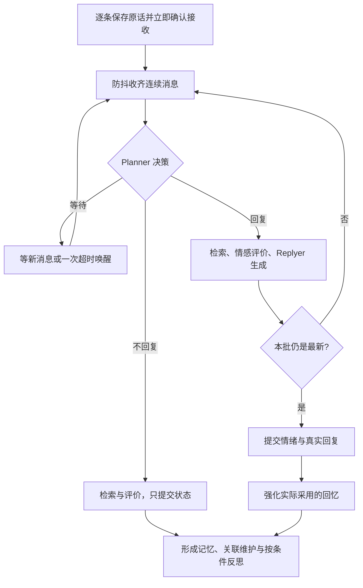

# 四系统初版：对话与记忆实验室

后端是 FastAPI；前端在 `E:\FlutterProject\ai_app`。Generative Agents、A-Mem、Sentimo 仅作为参考，本次没有修改它们。

第一次阅读实现，先看 [代码学习指南](代码学习指南.md)：从一次交流的调用流程理解人物状态、情感、记忆和对话，再按入口阅读源码。

Linux 服务器打包部署见 [Docker Compose 部署步骤](deploy/部署步骤.md)。

## 启动

先在 studyAgent 根目录运行后端：

```powershell
cd E:\AgentProject\studyAgent
uv sync
uv run python agent-system/main.py --host 0.0.0.0 --port 8000
```

保留并使用 `agent-system/.env` 中已有的模型配置。配置格式见 [.env.example](.env.example)。当前适配 LangChain 的 **OpenAI 兼容接口**，文字模型和向量模型可以使用不同服务地址。原生厂商 SDK 适配不在这一版内。

另开终端启动 Flutter：

```powershell
cd E:\FlutterProject\ai_app
flutter pub get
flutter run -d chrome --web-port 7357 --dart-define=API_BASE_URL=http://127.0.0.1:8000
```

也可使用 Windows 桌面或手机。页面右上角的服务器按钮能修改本次运行使用的后端地址。浏览器和桌面本机用 `http://127.0.0.1:8000`；Android 模拟器用 `http://10.0.2.2:8000`；真机用电脑的局域网 IP，例如 `http://192.168.1.10:8000`，手机与电脑在同一网络，并允许电脑接收 8000 端口连接。手机上的 `127.0.0.1` 指手机自身。

接口文档：<http://127.0.0.1:8000/docs>。初版面向一个本地用户和一个角色，不含账号体系；使用一个后端进程运行。

## 已实现的业务边界

| 系统 | 代码入口 | 初版行为 |
| --- | --- | --- |
| 人物状态 | [service.py](agent/systems/character_state/application/service.py) | 保存精力、忙碌程度、活动、焦点、环境、意图；结合情绪计算本轮注意力；通过界面显式调整 |
| 情感 | [service.py](agent/systems/emotion/application/service.py) | 模型评价角色的反应；规则混合情绪、按时间向基线恢复；参考 Sentimo 的状态与调节思路 |
| 记忆 | [service.py](agent/systems/memory/application/service.py) | 形成事件、维护背景和语义关联、检索、反思、证据追溯、实际回忆强化 |
| 对话 | [service.py](agent/systems/dialogue/application/service.py) | 汇总状态、情绪、近期原话、相关回忆，一次模型调用生成正文和实际采用的记忆 ID |

初版将相邻的小功能合在一个 `service.py`，没有照设计文档把每个动作都拆成独立文件。先看实际文件，不必逐个阅读早期规划中的全部类名。

人物状态中的活动和环境由你手动设置；这一版不自动模拟角色一天的生活，也不因用户说“我累了”就改写角色的精力。情感对状态的影响先体现在注意力评价中。情绪混合与记忆曲线中的常数均为可调的工程规则，不是经过心理学验证的个体模型。

## 一次交流怎样运行

四系统前增加了 [回复协调层](agent/application/reply_control/README.md)，参考 MaiBot 的私聊调度、Planner 与 Replyer 分工。它位于应用编排层，不新增一个人物业务系统。



发送接口先保存消息，返回 HTTP 202；独立工作线程按顺序处理角色的决策、回复与记忆整理。Flutter 每秒读取当前会话活动和真实新消息，实验室每 2 秒刷新。处理期间可以继续发消息，不需要等模型完成。没有伪造的逐字输出。

正常回复一批有 **Planner、情绪评价、对话、记忆形成四次文字模型调用**，达到反思条件增加一次。Planner 选择等待时只调用 Planner；选择不回复时省略对话调用，仍整理记忆。文字模型返回 JSON 并由 Pydantic 校验，不偷偷换模型或重复重试。向量接口用于查询及新增/更新索引。

默认采用 MaiBot natural 档的纯文字私聊规则：安静开批等 2 秒，30 秒内再次开批等 5 秒，同一批续发重算为 2 秒，整批防抖最多 8 秒。8 秒是进入判断前的收集上限，不是回复耗时保证。Planner 可另行选择等待；新消息会提前唤醒。本批至多超时复判一次，再次要求定时等待时改为只等新消息，避免无人发言时不断消耗调用额度。

新消息到来时，已启动的远端同步调用未必能立即停止；其过时正文不发送，也不据此强化记忆或提交候选情绪。回复一旦已经发布，其记忆整理会继续完成，下一批消息随后处理。判断理由、等待、合并和过时丢弃都记录在变化日志中。

反思触发条件：本轮有新事件、积累至少两次不同观察，且未反思事件达到 3 条或重要性之和达到 15。每次最多处理 12 条事件、生成 2 条认识；允许没有值得提炼的认识。每条 thought 至少引用两条不同的候选事件。实验室会展示“等待反思”或“新增 0 条”的原因。

## 三层记忆怎样保存

| 层 | 存储和结构 |
| --- | --- |
| 完整历史 | `storge/sqllite/history.sqlite3` 的 `messages`：一条实际发言一行，包含 ID、会话、角色、正文、时间和回复目标 |
| 短期窗口 | 从本批输入之前选择当前会话最近 12 条消息，再限制为 12000 字符；当前一批输入单独加入一次，保留各自 ID 与时间 |
| 长期记忆 | SQLite 保存节点正文、语义说明、来源、证据、关联、保留状态；`storge/chromadb` 保存 event/thought 的向量及可检索文本，ID 与 SQLite 的 `node_id` 一致 |

短期窗口滑出不会删除历史。新建会话清空当前的短期窗口；同一角色的长期记忆继续保留，仍可用于新会话。侧栏“隐藏会话”保留历史和记忆。

长期数据分开保存，避免把所有字段混装进一个节点：

| SQLite 表 | 内容 |
| --- | --- |
| `memories` | `chat/event/thought` 类型、描述、主谓宾、时间、有效性、重要性、关键词、背景、标签、类别、索引状态 |
| `memory_sources` | 长期记忆 → 原始消息 ID；event 以用户原话为来源，chat 引用双方原话 |
| `memory_evidence` | thought → 生成认识所依据的记忆 ID，有方向 |
| `memory_links` | 普通语义关联，无方向；同一对节点只保存一次 |
| `memory_retention` | 初始强度、强化后基准强度、稳定性、基准时间、回忆次数与上次回忆时间 |
| `memory_processing` | 关联整理、反思是否已处理 |
| `character_states` / `emotion_states` | 两个系统各自的状态快照 |
| `turns` / `events` | 每轮处理状态、错误、阶段输入和结构化结果，以及字段变化 |
| `runtime_settings` | 模拟时间偏移 |

`attention`、`emotional_impact` 不属于 `MemoryNode`，分别由状态系统和情感系统产生，用于形成记忆时初始化保留状态。它们可在本轮日志中追溯。完整原话不会因强度低而被改写。

连续消息仍逐条保存在 messages/turns；同一批通过 `batch_leader_id` 关联到最后一条消息的处理记录，`reply_action` 保存 reply/wait/skip。统一回复引用本批最后一条用户消息，长期节点保留这一批的真实来源消息 ID；不发言时不会伪造 assistant 历史。

## 北京时间与回复风格

数据库、API、提示词与界面统一使用北京时间（Asia/Shanghai，UTC+08:00），写入带 `+08:00` 的 ISO 时间。重启后的首次初始化会先创建 `storge/sqllite/history.before_beijing_*.sqlite3` 备份，再一次性转换旧时间字段和日志中的结构化时间；不会改写用户原话、正文或实际时间点，不影响衰减结果。已有表的 SQL 默认值不重建，应用始终显式传入北京时间；新库的 SQL 默认值也为北京时间。

提示词参考 MaiBot 的人设、表达风格与私聊场景分块，日常回复通常一到三句，不每轮都开导、总结或追问；技术问题仍可展开。当前日期、星期和早晚由本轮北京时间提供。实现见 [builder.py](agent/systems/dialogue/prompting/builder.py)，没有照搬麦麦的人设、群聊逻辑或插件框架。

记忆强度不混入检索相似度。初版候选排序为相关性、重要性、近期性，再有限扩展证据和普通关联；强度作为回忆清晰程度传给回复模型。低强度仍可能被检索到。只有回复模型报告实际采用、且确实属于本轮候选的记忆，才增加回忆次数。

明确纠正旧认识时可用 `supersedes_id` 将旧节点标记失效；依赖失效证据的 thought 不再作为有效回忆。这只是初版的纠正机制，尚未实现完整的事实时间线和冲突裁决。

SQLite 是主数据，Chroma 是可重建的检索索引。向量接口失败时，已保存的回复和记忆不会丢失，该轮显示“部分完成”；存储页可重试待补索引。更换向量模型或服务地址会触发配置检查，不能把旧索引与新向量混用。

## 界面怎样观察

聊天页右上角进入“记忆实验室”：

1. **记忆结构**：三列图，支持拖动、缩放、搜索、类型筛选和节点详情。虚线是来源，紫线是反思依据，绿线是普通关联。为保持图可读，显示筛选结果中最近 80 个节点，列表包含全部节点。节点详情包括完整字段、原始消息、保留状态和实际保存位置。
2. **变化记录**：查看检索候选、状态评价、情绪前后变化、实际回复上下文、模型的结构化输出、记忆形成、关联维护、强化与反思进度。页面显示最近 100 条阶段日志；完整记录保存在 `events` 表。这里不是模型隐藏思维过程。
3. **状态与存储**：修改人物状态、查看情绪数值；按表分页查看 SQLite 记录和建表 SQL；查看 Chroma 的 ID、嵌入文本和元数据样本；重试失败索引。

右上角时钟推进的是**统一模拟时间**，不移动或篡改历史记录的时间戳。记忆读取时计算衰减，情绪按流逝时间恢复。日志保留强度及情绪变化前后值，时间偏移在重启后仍保留。

聊天页顶部的“人物状态与情感”面板每 2 秒读取轻量 `/api/status`，不额外调用模型或检索。宽屏默认展开，手机点击展开，显示人物状态和六维情绪及变化依据。情绪候选在 `emotion_appraised` 中可观察；只有当前批次仍有效时才提交真实状态，过时批次的评价不会重复累加。

注意：按条数保留的短期原话不会仅因推进时间就滑出。测试长期记忆衰减时，推进时间后**新建一个会话**再追问，避免近期原话直接提供清晰答案。

## 建议的第一次测试

### 日志与模型输出失败

出现错误时，优先打开实验室的“变化记录”，找到同一处理编号的 `model_failed` 和 `failed` 事件。模型输出校验失败会记录结束原因、Token 用量、正文长度和可见回复摘要；不保存隐藏推理内容或 API Key。后端启动终端也会打印带处理编号的异常堆栈。Flutter 调试日志可在 IDE 的 Debug Console 中查看；Chrome 调试可按 F12 打开 Console。

当前请求在接口层设置 `response_format={"type":"json_object"}`，再用 Pydantic 校验字段；不再仅靠提示词约定 JSON。百炼 GLM-5.3 支持此 JSON 模式，见 [官方模型文档](https://www.alibabacloud.com/help/zh/model-studio/glm)。旧版失败响应未保存的正文无法事后还原，新诊断从更新后发出的请求开始记录。

如果错误明确显示 `finish_reason=length`，说明输出被截断，应先查看用量，再按需在 `.env` 调整 `LLM_MAX_TOKENS` 并重启。不会自动放大输出上限或额外重试。没有完整 JSON 时不伪造成功回复，也不把隐藏推理当作回复。

百炼 GLM-5.3 的输出上限包含推理与最终回复。当前本地配置已显式设置 `LLM_MAX_TOKENS=16384`、`LLM_REASONING_EFFORT=low`；GLM-5.3 不支持关闭思考，支持 low/high/max 三档，见上方官方文档。体验模型也需要遵守单次生成参数，不能把体验额度与单次输出上限混为一谈。新值需重启后端才会生效，可在“模型与实际存储路径”或 `model_start` 阶段查看实际生效配置。

SDK 有时会在 `invoke` 返回之前抛出 `LengthFinishReasonError`。网关现已捕获该异常，记录截断阶段及推理 Token 用量，输出可读错误；不会重复发起模型请求。已经结束的 partial 轮次不会自动补跑失败的记忆整理，已保存原话与回复仍然保留。

### 交流与记忆

无需导入模拟记忆，直接连续聊天：

1. “我最近喜欢去图书馆看书，三楼靠窗那里很安静。”
2. “我在家容易被打断，所以这周又去图书馆待了一下午。”
3. “有时候我不是真的在意看了几页，只是想找个安静的地方。”
4. 进入实验室，看是否形成 event、是否积累/生成 thought，以及证据能否回到你刚说的原话。模型允许返回空结果，不保证这些句子必然生成某条指定认识。
5. 新建会话问“你知道我为什么总去图书馆吗？”，观察检索与采用的记忆，不只比较措辞好不好听。
6. 推进 60 天，再新建会话问相同问题，比较清晰程度、回答细节和强化日志。
7. 调低精力、调高忙碌程度，提供一条包含主线和次要细节的新消息，检查本轮注意力及新记忆强度的初始化。

## 阅读顺序和验证边界

先看 [coordinator.py](agent/application/reply_control/coordinator.py) 的接收与调度，再看 [runtime.py](agent/application/runtime.py) 的 `process_pending`，之后阅读四系统的模型与服务。存储在 [database.py](agent/infrastructure/persistence/database.py)，接口在 [api.py](agent/api.py)。早期目录规划保存在 [agent/README.md](agent/README.md)。

离线验证命令（在 studyAgent 根目录）：

```powershell
uv run python -m unittest discover -s agent-system/tests -v
```

测试使用临时数据库、文字模型替身与确定性向量，覆盖编排、来源/证据/关联、真实本地 Chroma 持久化、时间衰减、幂等提交、部分失败和接口校验。它不代表真实模型的语义判断、反思质量或手机实机联调已验证。真实接口调用和体验由你继续测试。
